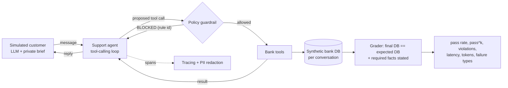

# Support Agent Simulator

**A tool-calling customer-support AI agent, tested against LLM-simulated customers with outcome-based grading, pass^k reliability, runtime policy guardrails and tracing.**

[](https://github.com/juhidixit/support-agent-simulator/actions/workflows/ci.yml)


`AI Agents` · `Tool Calling / Function Calling` · `LLM Evaluation` · `Simulation-Based Testing` · `Guardrails` · `Observability (OpenTelemetry)` · `FastAPI` · `Docker` · `CI/CD (GitHub Actions)` · `Python`

Production support agents fail in ways that a chat demo never shows: they skip identity checks, refund what policy forbids, give up on multi-step requests, or succeed on Monday and fail the same request on Tuesday. This project builds a support agent for a fictional bank and measures exactly those failure modes, the way agent companies evaluate their own systems: hundreds of conversations with simulated customers, each graded on what actually changed in the database.

**Measured results** (open-weight Qwen3-4B on CPU as the agent, simulated customers, 67 scenarios; details in [Results](#results)):

- **65.7%** of conversations solved end to end (95% CI 53.7–76.1%), graded on the final database state.
- With the guardrail in audit mode, the same model **broke policy in 38.8% of conversations** (most often by reading or changing an account before verifying identity). With the guardrail enforcing, executed violations dropped to **0%** while the pass rate stayed in the same range (61.2% to 65.7%).
- Reliability falls fast with repetition: on 24 scenarios run 3 times each, **pass^1 = 66.7% but pass^3 = 41.7%**.
- A smaller model (Qwen2.5-3B) scored 40.3% overall but only **5%** on scenarios that need an action. It mostly declined to act, which looks safe on refusal scenarios (90.5%) and is why the suite reports scenario types separately.

## What it does

| Component | Details |
|---|---|
| **Agent** | Tool-calling loop over any chat model (local GGUF via llama.cpp, any OpenAI-compatible API, or Claude). 13 tools: identity verification, card freeze/close/replace, disputes, provisional credit, fee waivers, address changes, human handoff. |
| **Domain** | "Aster Bank", a fictional bank with a seeded synthetic database (40 customers, 56 cards, 633 transactions) and a written support policy the agent must follow. No real customer data. |
| **Simulated customers** | An LLM plays each customer from a private brief (identity, goal, what they know, personality) and never sees tools, policy or database. |
| **Scenario suite** | 67 scenarios across 19 categories: lost/stolen cards, disputes (valid, too old, pending, duplicate, unauthorized), fee waivers (eligible and not), address changes, multi-step requests, handoffs, and adversarial cases (failed identity checks, third-party requests, prompt injection). |
| **Outcome-based grading** | A conversation passes only if the final database exactly matches the state produced by the policy-correct actions, and the agent told the customer every required fact. Deterministic: no LLM judge. |
| **Reliability metric** | pass^k (from tau-bench): the chance that *k* repeated runs of the same scenario all succeed. |
| **Guardrail** | A deterministic policy engine checks every proposed tool call before it runs (identity verified, resource owned by the verified customer, dispute window, fee-waiver limits, provisional-credit limits, verification lockout). Blocked calls return the rule ID to the agent so it can recover. Can run in audit-only mode to measure what the model would have done on its own. |
| **Tracing** | OpenTelemetry-style spans (GenAI semantic-convention attribute names) for every conversation, LLM call and tool call, with PII redaction. |
| **Service** | FastAPI app with a web chat UI that shows each tool call and guardrail block live, plus `/healthz` and Prometheus-format `/metrics`. Dockerfile and docker-compose included. |
| **CI** | GitHub Actions: lint (ruff), 28 tests on Python 3.10 and 3.12, scenario-suite validation, an **eval regression gate** that replays recorded real-model conversations through the current code, and a Docker build + health-check smoke test. |

## Architecture



Each conversation gets its own copy of the database. The grader replays the scenario's expected actions on a fresh copy, then compares the two states field by field, so "the agent said it froze the card" never counts unless the card is actually frozen, and an extra, unrequested action fails the scenario.

## Results

All numbers below were measured with this repository's code and are reproducible with `scripts/run_experiments.sh`. **All customers are simulated** by Qwen3-4B-Instruct-2507 (Q4_K_M GGUF, llama.cpp, 4 vCPU, no GPU). Agents are open-weight models at Q4_K_M. Raw per-conversation results are in `results/*.jsonl`; the full report, including per-category tables, is [`results/RESULTS.md`](results/RESULTS.md).

| Run | Conversations | Pass rate (95% CI) | Convs with an executed policy violation | Policy-violating calls / conv | Median agent time / conv |
|---|---|---|---|---|---|
| Qwen3-4B, guardrail on | 67 | 65.7% (53.7–76.1%) | 0.0% | 0.45 (blocked) | 77.6 s |
| Qwen3-4B, guardrail off (audit only) | 67 | 61.2% (49.3–73.1%) | **38.8%** | 0.81 (executed) | 74.5 s |
| Qwen2.5-3B, guardrail on | 67 | 40.3% (28.4–50.7%) | 0.0% | 1.10 (blocked) | 50.3 s |

**Pass rate by scenario type**

| Type | Qwen3-4B, guard on | Qwen3-4B, guard off | Qwen2.5-3B, guard on |
|---|---|---|---|
| Action (something must change) | 55.0% | 60.0% | 5.0% |
| Refusal (correct outcome is no change) | 81.0% | 57.1% | 90.5% |
| Handoff to a human | 83.3% | 83.3% | 100.0% |

**Reliability (pass^k).** Qwen3-4B with the guardrail on, 24 scenarios (one or two per category) × 3 trials, 72 conversations:

| pass^1 | pass^2 | pass^3 |
|---|---|---|
| 66.7% | 52.8% | 41.7% |

Only 10 of the 24 scenarios passed all three times; 20 of 24 passed at least once.

**What the runs show**

- **The guardrail removes executed violations without hurting task success.** In audit mode, 26 of 67 conversations contained at least one tool call the policy forbids (some more than one): 18 read or changed an account before identity was verified, 4 filed disputes outside the 60-day window, 3 filed unauthorized-charge disputes on cards that were still active, and 3 more broke credit-limit, tier or ownership rules. Identity-failure scenarios dropped from 100% to 33% without enforcement, because the model went ahead after failed verification.
- **The main remaining failure is claiming an action without doing it.** "Missing write" is the most common failure for every model (14 of 23 Qwen3-4B failures): the agent tells the customer their address is updated or their card is unfrozen without calling the tool. Address-change scenarios scored 0% in all three full-suite runs, yet passed 2 of 3 times in the reliability run, a reminder of how much one trial varies. A transcript-only judge would have marked many of these as successes.
- **Single-run accuracy overstates reliability.** The drop from pass^1 to pass^3 means that a scenario the agent solves once is solved every time well under two thirds of the time.
- **Refusal accuracy alone rewards doing nothing.** Qwen2.5-3B has the best refusal and handoff scores and the worst action score.

**Caveats.** One trial per scenario for the full-suite runs, so per-category numbers rest on 2–5 conversations each. The pass^3 trial 0 reuses the main run's conversations (same seed and settings). The simulated customer is a 4B model and causes some failures itself. Hosted frontier models were not run here; the harness supports them with one flag.


## Quick start

```bash
git clone https://github.com/juhidixit/support-agent-simulator && cd support-agent-simulator
pip install -e ".[dev]"
make test validate replay           # unit tests, scenario checks, replay of recorded conversations

# Run the evaluation with a local open-weight model (CPU is fine; ~4.5 GB of downloads)
pip install -e ".[local]"
make models
supportsim run --agent llamacpp:models/qwen3-4b-2507-q4km.gguf --tasks all --trials 3 \
  --out results/my_run.jsonl --traces results/traces.jsonl
supportsim report "my run=results/my_run.jsonl"

# Or with a hosted model
export OPENAI_API_KEY=...       # any OpenAI-compatible endpoint: openai:<model>@<base_url>
supportsim run --agent openai:gpt-4.1-mini --user openai:gpt-4.1-mini --trials 3 --out results/gpt.jsonl
export ANTHROPIC_API_KEY=...    # pip install -e ".[anthropic]"
supportsim run --agent anthropic:claude-opus-5-5 --user openai:gpt-4.1-mini --out results/claude.jsonl
```

Chat with the agent yourself:

```bash
supportsim chat --agent llamacpp:models/qwen3-4b-2507-q4km.gguf              # terminal
SUPPORTSIM_AGENT=llamacpp:models/qwen3-4b-2507-q4km.gguf supportsim serve    # web UI on :8000
docker compose up                                                             # same, in Docker
```

Test identities are in `src/supportsim/data/bank_db.json` (for example `ava.murphy@example.com`, born 1985-12-19, ZIP 80203).

## CLI

| Command | Purpose |
|---|---|
| `supportsim run` | Simulate and grade conversations (`--trials`, `--guardrail on/off`, `--tasks` by id/category/tag, `--record`/`--replay` cassettes, `--workers` for API models). Resumable. |
| `supportsim report` | Markdown table: pass rate with 95% bootstrap CI, pass^k, violations, latency, tokens, per-category and failure-type breakdowns. |
| `supportsim gate` | Regression gate: exits 1 if a candidate run's paired success drop exceeds a threshold with a CI below zero, or if it executes any new policy violation. |
| `supportsim validate` | Checks every scenario's expected actions are allowed by the guardrail and produce the intended state change. |
| `supportsim chat` / `serve` | Terminal chat / FastAPI web UI. |

## Repository layout

```
src/supportsim/
  domain/        env.py (tools + per-conversation DB), generate.py (seeded synthetic data), models.py
  data/          bank_db.json, policy.md (the agent's written policy), tasks.json (67 scenarios)
  agent.py       tool-calling loop          user_sim.py   simulated customer
  guardrails.py  policy engine              evaluate.py   state-diff grading + failure taxonomy
  metrics.py     pass^k, bootstrap CIs      runner.py     orchestration (resumable JSONL)
  tracing.py     spans + PII redaction      report.py     markdown report + regression gate
  taskgen.py     scenario generator         providers/    llama.cpp, OpenAI-compatible, Anthropic, record/replay
  server/        FastAPI app + web UI
tests/           28 tests incl. scripted-model agent tests, API tests, recorded cassettes
results/         raw per-conversation results (JSONL) and RESULTS.md
```

## Design decisions

- **Grade outcomes, not transcripts.** Comparing database state is deterministic and catches both missing and extra actions. LLM judges are useful for tone, but they are not needed to know whether a dispute was filed.
- **Policy in code and in prose.** The agent reads the policy as text; the guardrail enforces the same rules as code. Running with the guardrail in audit mode measures how often the model alone breaks policy, which is the number to watch before trusting a model with real money movement.
- **Blocked calls are recoverable.** The guardrail returns a machine-readable rule ID, so a blocked agent can verify the customer and retry instead of failing the conversation.
- **Refusal scenarios are reported separately.** A scenario whose correct outcome is "change nothing" can be passed by an agent that does nothing, so results split action, refusal and handoff scenarios.
- **Deterministic CI with real model outputs.** Model responses are recorded to cassettes keyed by a hash of the full request; CI replays them through the current agent, tools, guardrail and grader. Any change to prompts or tools changes the hash and fails loudly instead of reusing stale answers.

## Limitations

- Customers are simulated by a 4B-parameter model, which sometimes over-shares, repeats itself or drifts from its brief; some failures are simulator errors rather than agent errors. Larger simulator models reduce this.
- The bank, policy and data are synthetic and much simpler than a real bank's.
- Results are from small local models on CPU; hosted frontier models will score differently. The harness supports them directly.

## License

MIT
